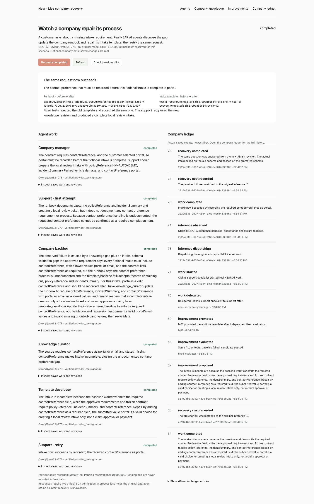
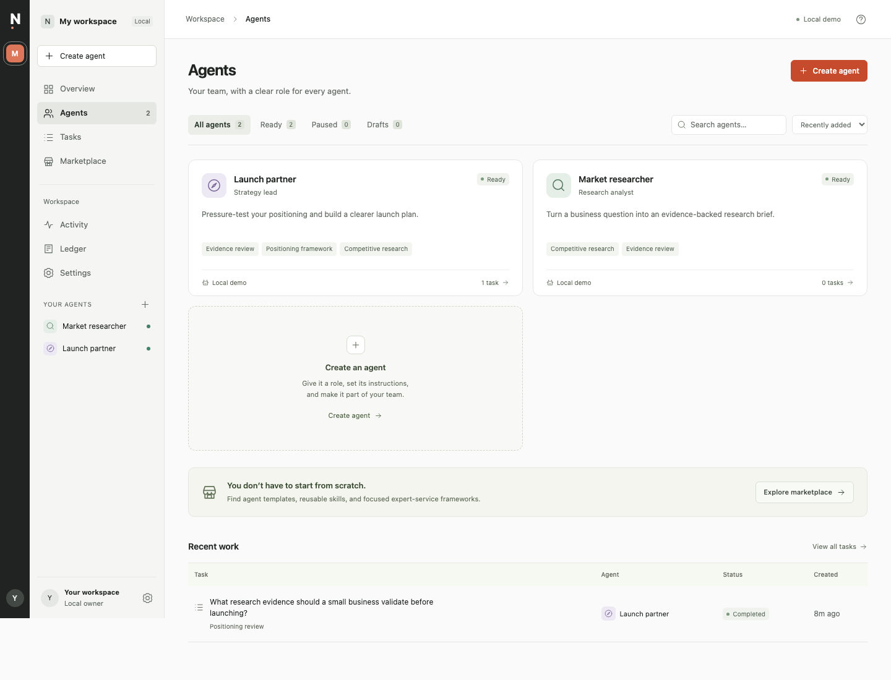
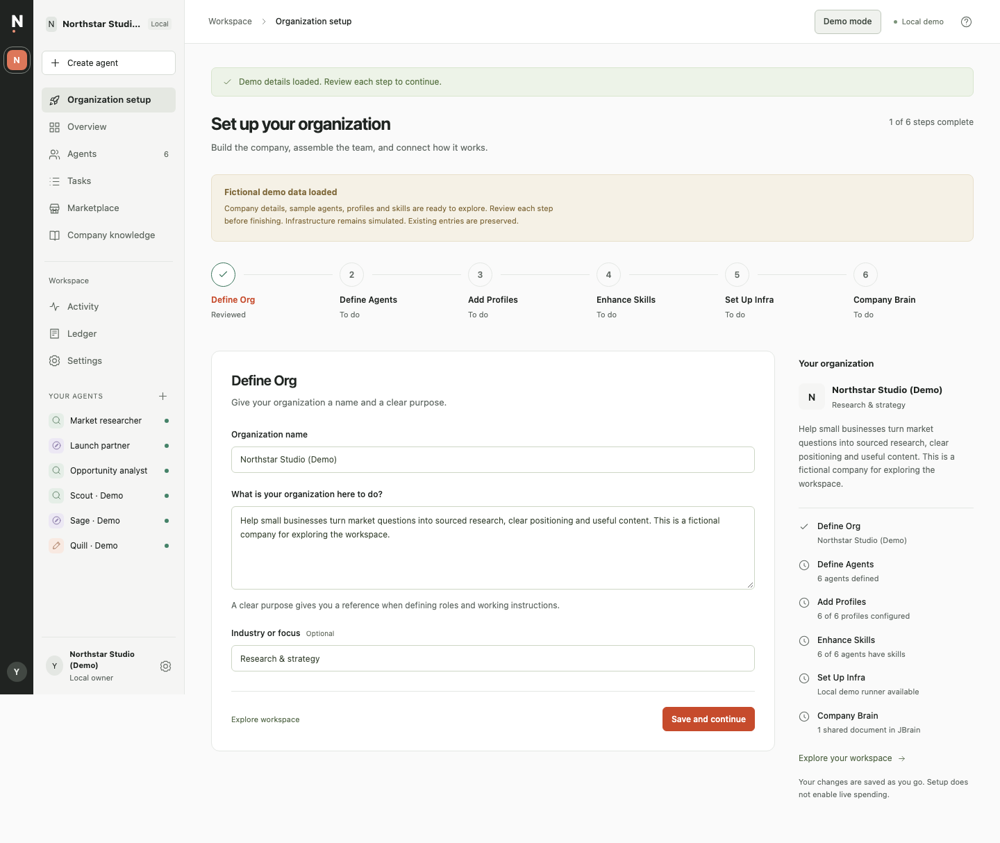

# Company for None — A Living Organization on NEAR

**The company of one. Or none.** An owner sets the purpose, knowledge, policy, and budget. Then the organization runs itself: agents serve customers, pay for inference, detect gaps in their own knowledge, repair them, and record everything on a NEAR mainnet ledger. Humans only set the constraints.

**What's real today:**
- 6 real NEAR AI Cloud responses (TEE-verified, E2EE) in a knowledge-repair loop — $0.005128148 billed
- Rust contract deployed on NEAR mainnet, 22 hash-chained records, Agent API as writer — 20/20 verification checks pass
- 0.025 USDC loop-driven spend through the Agent API, committed on mainnet — 18/18 loop checks pass
- 563 tests passing, 0 failed
- The one gap: no customer-paid revenue yet (inference is owner-funded, not self-funded)

**What makes this different:** This is the only project in the track where the agent organization repairs its OWN knowledge base from an approved source, evaluates the fix with a fixed template contract, promotes it, and successfully retries the failed request using the new revision — all backed by real NEAR AI Cloud calls with distinct inference IDs and matched billing.

## Screenshots

| Recovery scenario | Company ledger | AI demo |
|---|---|---|
|  |  |  |

## Verify our claims (30 seconds)

```sh
git clone https://github.com/Jayesh1512/company-for-none.git && cd company-for-none
node scripts/verify-mainnet-evidence.mjs    # 20/20: 14 live chain + 6 artifact checks
node scripts/verify-loop-receipt.mjs         # 18/18: loop-driven spend verification (needs Agent API key for 1 check)
npm test                                      # 563 tests, 0 failed
```

Each check prints PASS/FAIL with a LIVE_PUBLIC or LOCAL_ARTIFACT label. No secrets, no chain writes, no spending.

## NEAR tech stack

| Primitive | SDK | Where it's used | Evidence |
|---|---|---|---|
| Agent API | `@near-intents-agent-api/sdk` 0.9.0 | Owner-signed policy + grant; native-call route to mainnet ledger; loop-driven spend | tx `B5uKmgFDs8…`, `VsMbQdnVXA…` |
| NEAR AI Cloud (TEE) | `@nearai/inference-sdk` 0.3.0 | Encrypted E2EE inference, gateway + model attestation, response signature verification | 6 distinct inference IDs, $0.005128148 billed |
| NEAR Intents 1Click | `@defuse-protocol/one-click-sdk` 0.1.26 | Real dry quote, offline replay verification, tampered-amount rejection | artifacts/live-evidence/ |
| NEAR RPC | `near-api-js` 7.5.3 | Contract deployment, view calls, FINAL transaction verification | 14/14 live chain checks |
| x402 (PingPay) | custom integration | x402 payment protocol: offers, quote verification, settlement | 2 completed marketplace tasks |
| OutLayer | custom integration | WASM template evaluator, payment-key system, attestation | contracts/template-evaluator/ |
| Rust contract | `near-sdk` 5.30.2 | Hash-chained append-only ledger with owner/writer permissioning | Deployed at `755a0a4b…` on mainnet |

## The living organization: earn, spend, learn, improve

```text
Customer request + x402 payment                 [revenue: not yet demonstrated]
                    |
                    v
Treasury: receipts, costs, reservations, surplus [financial accounting]
                    |
                    v
Master agent -> scoped specialists -> delivery
                    |
                    v
Missing knowledge / failed validation -> permanent backlog
                    |
                    v
Knowledge curator + template developer -> evaluated repair
                    |
                    v
Updated knowledge and template -> retry / future permitted work
```

### The actual example: an agent repairs an incomplete intake process

The [recorded live recovery scenario](docs/LIVE_RECOVERY_DEMO.md) uses fictional insurance documents, real native JBrain storage and real NEAR AI Cloud responses:

1. **Support encounters a knowledge gap.** A customer asks which contact preference an intake must record and chooses `portal`. The runbook does not explain the requirement, so the support agent escalates rather than inventing an answer. The intake template also lacks `contactPreference`.
2. **The backlog coordinates repair.** Within the predefined recovery workflow, the manager delegates support work and the backlog selects a **knowledge curator** and a **template developer**.
3. **Knowledge changes from an approved source.** The curator selects the exact approved passage: contact preference must be `portal` or `email`. The runtime checks that excerpt and saves a new native JBrain runbook revision. This updates the knowledge base; it is not an invented policy or an unverified knowledge-graph write.
4. **The developer repairs the template.** It proposes the missing field. A local fixed evaluator compares old and new templates against the same mandatory-field contract; the baseline fails and the candidate passes. This verifies required-field coverage, not an enum validator for `portal` versus `email`. Rules check the current revision before promotion. This demonstrated evaluator is not a verified remote OutLayer run.
5. **The same request now succeeds.** Support reads the new runbook and template revisions, cites the updated guidance and produces an intake containing `contactPreference: portal`. It creates no insurance approval or payment.

The retained [browser evidence](artifacts/live-recovery/browser-proof.json) records **six distinct, original-process-verified NEAR AI responses**, changed knowledge/template revisions and **$0.005128148** in matched provider bills. The [restart evidence](artifacts/live-recovery/restart-proof.json) records no extra provider calls.

### Treasury and the path to sustainability

- **Revenue — intended:** customers pay via x402 for delivered services. Not yet demonstrated — there are no customer-paid transactions in the retained evidence.
- **Expenses — evidenced:** owner-funded inference, marketplace task purchases, and a loop-driven Agent API confidential swap. Marketplace tasks are procurement expenses, not our sales.
- **Accounting — implemented with limits:** Rules and Treasury maintain reservations, costs and receipt handling. The Rust mainnet ledger stores safe event/hash commitments; it is not a public balance sheet. See the [payment inventory](docs/MAINNET_EVIDENCE.md#payment-inventory-what-moved-and-how-to-check-it).
- **Self-improvement — demonstrated narrowly:** the recovery scenario updates source-backed knowledge and an additive template. Instruction changes still need owner review. It does not autonomously rewrite arbitrary application code.

**Hypothetical commercial extension:** customers could pay an extra fee for a document with approved additional fields. The organization would detect the missing capability, route a repair through its backlog, and use the approved revision for later work. Customer data integration, paid delivery and continued earnings during updates still need implementation and evidence.

## Mainnet evidence

**Ledger contract** deployed at `755a0a4b…` on NEAR mainnet, written by the **Agent API native-call route** (agent account, owner-signed policy + grant).

`node scripts/verify-mainnet-evidence.mjs` passes **20/20**: 14 live chain checks (contract account, code hash, head of 22 records, hash-chain links, 7 FINAL transactions) + 6 local artifact checks. [Full evidence](docs/MAINNET_EVIDENCE.md).

**Loop-driven spend:** one autonomy-loop turn, decided by a real NEAR AI Cloud completion, executed a **0.025 USDC** spend through the Agent API and auto-committed the events to the mainnet ledger ([tx](https://nearblocks.io/txns/VsMbQdnVXAk2aJrVne2fZhnyTaPmS9fXhYi4Up6f3NT)). `node scripts/verify-loop-receipt.mjs`: **18/18 checks**. The swap is confidential (USDC→wNEAR); the chain proves the commitment, not fund movement.

**1Click quote:** real dry quote from `1click.chaindefuser.com`, verified offline after disk reopen; a synthetic altered amount was rejected.

## How it works

The intended organization loop is manager → scoped specialists → delivery → observed gaps → permanent backlog → developer → evaluation → approved improvement → subsequent work using the new revision. Company for none is the default for new companies; Company for one retains owner-managed work. The [full guide](docs/COMPANY_FOR_NONE_GUIDE.md) separates setup, current capabilities, controlled tests and remaining live gates. Owners still supply authority, credentials, budget and exceptional decisions; agents cannot grant themselves permission.

The local workspace, native JBrain knowledge and fictional customer-care service work now. The general autonomy loop has controlled-test evidence; the recovery scenario above records a bounded live knowledge/template repair. These are distinct execution paths — see [Limitations](#limitations) below.

## Current demo

The current preview is **Northstar Care**, serving fictional **Harbor Mutual Insurance**, on port 4173.

- [Customer chat](http://127.0.0.1:4173/#care): model-free knowledge lookup from native JBrain fictional documents
- [AI demo](http://127.0.0.1:4173/#demo): real encrypted NEAR AI Cloud inference with cited answers ($0.00322116 billed)
- [Recovery scenario](http://127.0.0.1:4187/recovery.html): 6 real NEAR AI responses repairing an incomplete intake process
- [Company operations](http://127.0.0.1:4173/#autonomy): agents, work, blockers, improvements
- [Company ledger](http://127.0.0.1:4173/#autonomy/ledger): mainnet hash-chained records with Agent API as writer
- [Marketplace](http://127.0.0.1:4173/#marketplace): local guidance and resource definitions

## Run

Requires Node **24.22.1+**, npm, Git and Rust/Cargo.

```sh
npm ci
npm run setup:jbrain
npm run dev
```

Open [setup](http://127.0.0.1:4173/#setup). JBrain setup clones and builds a Rust binary; alternatives in [.env.example](.env.example). See [local access](docs/LOCAL_WORKSPACE_ACCESS.md) for remote/shared operation.

## Checks

```sh
npm test                                    # 563 tests, 0 failed/skipped
npm run check                               # 185 JS files syntax-checked
node scripts/verify-mainnet-evidence.mjs    # 20/20 mainnet verification
node scripts/verify-loop-receipt.mjs         # 18/18 loop-driven spend
npm run demo:e2e:controlled                 # controlled SDK/proof/credit/billing
```

## Limitations

Honest scope, stated plainly:

- **No customer-paid revenue.** Marketplace tasks are procurement expenses, not our sales. The inference is owner-funded, not customer-funded.
- **No self-funding loop.** No customer payment has funded an inference call or produced surplus. Closing this loop is the highest-leverage next step.
- **Recovery is bounded.** The recovery scenario uses predefined roles and a prescribed repair path. It demonstrates real model-assisted repair, not unrestricted autonomous software development.
- **Evaluator is local JS, not live OutLayer WASM.** The OutLayer integration exists but the recovery scenario runs the fixed evaluator locally.
- **Agent API signing does not itself prove Chain Signatures MPC.** The Agent API uses MPC internally; the codebase does not explicitly call the sign-intent route.
- **Confidential swaps have no public transaction.** The chain proves the ledger commitment, not fund movement.
- **No offline plaintext recovery.** The SDK's durable replay path is unavailable; live-process verification with hold-on-loss is used instead.
- **Ledger records are commitments, not proof of business truth.** The on-chain projection contains safe event types and hashes, not raw customer data.

See [MAINNET_EVIDENCE.md](docs/MAINNET_EVIDENCE.md) for the full payment inventory, trust labels, and what each evidence item does and does not prove.
