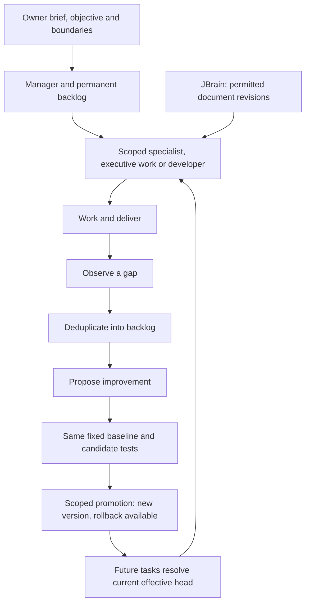

# How Company for None works

Current product guide · 14 November 2026

**Give the company an objective, knowledge and limits. Its agents should then organize the work, deliver results, find gaps and improve the next run.** The owner manages the company’s purpose and boundaries. The manager handles routine delegation. A permanent backlog keeps unresolved work visible.

This is the intended operating model. The local workspace and customer-care service work today. The full reasoning and improvement loop has controlled test evidence. Live accepted autonomous reasoning and funded commerce have the separate limits in the [status table](#current-capability-and-status).

The main **Open AI demo** entry now runs [actual encrypted NEAR AI](REAL_AI_DEMO.md) with an existing agent and selected native JBrain documents. Actual verified output and an owner-review ticket have been observed, costing $0.00322116 total. This owner-funded trial uses the expressly selected live-call verification policy; it does not establish the autonomous operating loop or Cloud credit purchase.

## A day at the company

The current local company is **Northstar Care**. Its client, **Harbor Mutual Insurance**, is fictional. Two saved support profiles use four real documents in native JBrain: fictional auto, home, travel and claims guidance.

Today a customer can open [customer chat](http://127.0.0.1:4173/#care), select Policy Guide and ask, “What is the auto collision deductible?” The app returns an exact approved passage with its source and revision. A request to approve a claim creates a persistent case in the [owner inbox](http://127.0.0.1:4173/#support). These are working model-free lookups and local tickets. No generated AI answer, insurance claim approval, insurer contact or email occurs.

With the required reasoning capability available, the intended routine would be:

1. **Receive the objective.** The owner asks Northstar Care to answer approved policy questions and identify gaps in its support material.
2. **Organize the work.** The manager assigns a scoped policy review to a specialist. The permanent backlog tracks missing information. Each role receives only its permitted JBrain context and tools.
3. **Deliver and observe.** The specialist returns a result. Unknown questions go to an owner ticket. A detected template defect becomes a backlog item, with its source and affected revision.
4. **Propose a repair.** A developer prepares a narrow change. For example, a fictional internal document template may omit a middle-name field that its registered test contract requires.
5. **Evaluate and promote.** The fixed evaluator runs the old and proposed template against the same mandatory tests. M01 checks the exact revision and permits a new active version only when the repair passes.
6. **Use the improvement.** Later tasks capture the new active template. Earlier task snapshots stay unchanged. The manager continues the objective within its remaining limits.

The middle-name example is a **document-template test**, not a legal insurance contract, a universal naming rule or a claim decision. This full chain is demonstrated with controlled reasoning in tests; it is not a record of Harbor Mutual running an autonomous insurance business.

## The operating loop

The diagram shows the **intended routine**. Status legend: **L** = implemented and locally verified; **C** = full chain verified with controlled reasoning; **E** = external evidence or owner input needed; **R** = remaining implementation. See the status table for each capability.

“Executive” describes a specialist’s assigned responsibility. The current command roles are manager, backlog, specialist and developer. A saved profile is real persisted configuration. It becomes a running agent only when a durable work claim starts. Setup uses Rules-defined manager and backlog profiles; a model does not invent bootstrap decisions.

**Company for one** lets the owner assemble and manage the team. **Company for none**, the default for new companies, is intended to let agents organize routine work after owner setup and Start. Choosing a mode does not change the provider execution mode or grant spending authority. Existing profiles and explicitly saved manual mode are preserved.

“None” means bounded agent operation with fewer routine owner decisions. The owner still supplies policy, budget, client authority and exceptional decisions. Agents cannot give themselves permission.

| Responsibility | Who performs it |
| --- | --- |
| Define purpose, policy, budget, document access; start, pause and review exceptions | Owner |
| Delegate scoped work; request resources; propose service drafts; report gaps; complete with a deliverable | Manager |
| Keep and triage gaps; delegate scoped follow-up; report results | Permanent backlog agent |
| Perform assigned specialist or executive work; request resources; report gaps and deliver results | Specialist |
| Propose template repairs or instruction/host-code review items; request resources; report results | Developer |
| Run the mandatory baseline/candidate cases and record observations | Fixed evaluator, not a model-written pass flag |
| Admit or hold each action, check current scope and revision, decide promotion and financial limits | M01 Rules |
| Reserve and record exact money/credit effects and original receipts | M03 Treasury |
| Supply current, permitted company documents | Native JBrain |

## How it heals

A detected gap has a stable identity tied to the company, target, base revision and failure. Repeat observations add occurrences to the same open item. The backlog assigns a developer rather than creating a new repair each time.

Automatic repair is narrow: add a field or require an allowed field in a registered company-owned structured template. The developer cannot edit the evaluator, mandatory tests, prior required fields or business permissions. The evaluator runs **the same frozen inputs against both baseline and candidate**. It must observe the relevant old failure, its repair and preserved regressions. Evidence binds the exact old/new content, contract, evaluator, tests and policy.

Promotion uses **compare-and-swap (CAS)**: change the active head only if it still names the evaluated base revision. A concurrent edit makes the proposal stale. Promotion writes an immutable revision and audit event. The actual context resolver used by internal work and workspace tasks reads that head for later admissions. A recorded “improvement” without a future consumer would not count as healing.

Instruction or prompt changes require an explicit owner decision. Acceptance requires the company to be paused with no active leases. It creates a revision for that named agent’s future instructions. Host-code proposals remain text: acknowledging one records `owner_acknowledged_manual` and runs nothing. Agents cannot rewrite money or privacy policy, Rules, grants, validators, credentials, dependencies or model weights.

An owner can roll back an applied target to prior content. Rollback creates another revision and audit event. It affects future context; it does not erase history or undo an external effect.

### How it stops a bad loop

Objective counters bound steps, calls, agent creation, input/result bytes and retries. They include failed attempts and persist across restart, pause and midnight. Cycle checks reject repeated ancestor assignments. Repeated proposals with no progress eventually hold. Parents wait for required child work and actual effect/cost reconciliation before completion.

A **lease** gives one worker temporary ownership. A **fence** invalidates an older worker after takeover or pause. Checks repeat before dispatch and local writes. A stable action identity makes replay **idempotent**: the same accepted command returns its result without another write; changed contents conflict. Initial capacity is one company work claim and one shared unresolved inference slot across internal, customer and component paths.

An **unknown effect** means a provider may already have acted. The company keeps its original identity and reservation, reads that operation and reconciles it. It does not blindly resend or buy again. An unchanged missing prerequisite does not consume another step on every timer tick. Owner interventions are specific: repair access, decide an instruction proposal, resolve an escalation, review a changed resource, roll back, or replace an exhausted objective when allowed. A new objective never erases old financial obligations.

See the [reviewed contracts](COMPANY_FOR_NONE_CONTRACTS.md), [current autonomy handoff](../handoffs/e2e-autonomy-sonnet.md) and [internal workflow](../src/workflow/internal.mjs) for exact recovery rules.

## How it upgrades

An upgrade means a versioned change in what this company uses:

- **Instructions:** owner-reviewed guidance for one named profile.
- **Templates:** fixed-evaluated structured company data with an active version and rollback.
- **Skills and SOUL:** exact versions and hashes of written guidance. SOUL profiles are independently authored; they imply no endorsement or extra authority.
- **Resources:** a verified binding to the actual entitled capability or delivered output, when that route exists.
- **Knowledge:** owner-approved documents and exact native JBrain revisions.

New work freezes the effective profile, instruction head, templates, catalog content and selected JBrain excerpts. Grants are checked again before inference. Granting document access and selecting that document for autonomous context are separate owner steps. Children receive a permitted subset of parent scope. An upgrade does not rewrite already frozen tasks or silently import another company’s private learning. This is operational improvement, not model training.

The [effective-context resolver](../src/autonomy/context.mjs) is the source of the shared template and named-agent instruction behavior. Ordinary documents remain JBrain-authoritative; structured template heads are journal-authoritative.

## How it should buy resources

The intended purchase path is:

1. **Discover** an exact resource and revision. Check the work’s need and any existing entitlement.
2. **Request** it with purpose, supplier, price and expected output or licence. A request is not a purchase.
3. **Admit** through M01: exact price, caps, refund route, current authority and common Treasury reservation must fit. The lifetime **USD5 actual-plus-pending ceiling** remains an upper bound.
4. **Execute** the exact provider effect under its original operation identity and final current checks.
5. **Reconcile** that original operation if its outcome or bill is pending or unknown. Never buy again to resolve uncertainty.
6. **Verify** the actual entitlement or delivered output. Bind the admitted revision to its intended consumer and audit the result and actual cost.

Free authored skills and SOUL guidance can be installed as local written resources within scope. Local marketplace definitions describe available guidance or a service’s inputs and deliverable; they do not establish a paid vendor connection.

A real task service sells an output. A reusable skill/persona licence grants specified reuse rights. The NEAR marketplace’s **x402/A2A task delivery is not a reusable skill licence**. Its adapter can bind a completed task to hashable delivered content, but records `licenseGranted:false` and unverified usage rights. Payment, a task ID or a URL alone is not delivery or licence proof.

Autonomous Cloud **cash-to-credit purchase is unsupported**. Organization balances are unwatermarked, nonadditive observations: reading a balance does not create deposits, owned credit or a spending grant. Current paid requests remain held as shown below. Details: [funding adapter](../src/cloud-funding/index.mjs), [supplier entitlement rules](../src/procurement/entitlement.mjs) and [business operation](BUSINESS_OPERATION.md).

## Selling work and serving customers

The working local customer-care listings lead to private conversations, cited policy lookup and owner tickets. Their publication approves exact fictional source revisions for that local service. It does not expose the general private company brain.

Manager-authored commercial services start as drafts against a known base service. The current draft path holds external publication. A local listing is not publication on NEAR Agents Marketplace, a paid sale, settlement or revenue. Those require separate approved terms, public context, payment, delivery and refund evidence. See [customer-care behavior and privacy](CUSTOMER_CARE.md).

## Current capability and status

This table is the current boundary between usable local behavior, controlled demonstrations and unfinished live operation. **There is no fully autonomous funded company claim.**

| Capability | Status | What is proved or still needed |
| --- | --- | --- |
| Setup, persisted roles, objectives, work, private lifecycle journal, owner controls and native JBrain | **L — implemented/local verified** | Real local records, grants, revisions and recovery. Bootstrap and review do not run a model. |
| Northstar Care customer portal and owner inbox | **L — implemented/local verified** | Two saved support profiles, four native JBrain fictional documents, local listings, exact cited lookup, private conversations and persistent tickets. No AI reply, real claim, email or external listing/sale. |
| Manager → specialist → gap → backlog → developer → evaluation → future version | **C — controlled full-loop test** | Real app/Rules/Treasury/native JBrain and fixed evaluator; synthetic SDK reasoning/proof/credit/billing. Shows mechanics, not live model judgment. |
| Additive template promotion/rollback; paused instruction review; inert host proposals | **L + C** | Implemented local mechanisms and controlled pipeline checks. Automatic semantic prompt or host-code repair is unavailable. |
| Owner-funded support AI trial | **Actual paid provider evidence** | Two official-SDK E2EE/live-verified calls: cited answer and persistent owner-review ticket, actual bills $0.00322116; restart reuses saved acceptance. Offline plaintext recovery is unavailable. [Exact scope](REAL_AI_DEMO.md). |
| Accepted live autonomous reasoning | **E — external capability and inputs** | Official NEAR SDK **0.3.0** lacks supported durable original plaintext replay/proof. Also needs private credentials, numerical price/token bounds, attributable scoped credit and exact work authority. A key alone cannot close the proof gap. No custom decryption or security-route switch is used. |
| Free Cloud attestation preflight | **L — actual public read** | New actual SDK0.3.0 preflight verifies fresh distinct gateway/model nonces, UpToDate TCB and attested gateway TLS. Both deployment-provenance checks are `not_checked`; no completion, GPU/output or durable plaintext proof. [Exact evidence](LIVE_EVIDENCE.md). |
| 1Click dry quote and public discovery | **Actual public evidence** | New HTTP201 `dry:true` quote verified by SDK0.1.26/default production root and verified again after offline disk reopen. Explicit synthetic amount tampering fails signature verification. HTTP200 public responses include64 models and231 tokens. No settlement/refund proof, accepted customer/deposit instructions, swap or spend. [Bytes, reproduction and limits](LIVE_EVIDENCE.md). |
| Paid procurement, reusable licences, external sales/settlement/refunds | **Separate paid-task artifacts; E + R for the complete flow** | Two separately invoked marketplace task purchases have retained completed-task outputs; they are not an autonomous procurement-to-consumption run or reusable licences. Exact funded scopes, independent movement/finality and executable remedies are still needed for the commercial flow. Autonomous Cloud purchase and skill-licence acquisition remain unsupported. [Scope and artifacts](MAINNET_EVIDENCE.md). |
| Rust NEAR ledger contract, safe hash records, reads, unsigned batches and checkpoint reconciliation | **L — actual LOCAL Sandbox verified** | Eight real checks on nearcore **2.6.2 and 2.14.1**. Private journal stores original data; public projection has ordered types/times and linked hashes. Hashes are commitments, not proof of business truth. |
| Mainnet deployment and operational ledger publication | **Deployed and written through Agent API; routine app publishing still gated** | The ledger account `755a0a4b…` is deployed, has six linked records, and uses Agent API account `b2c5b8f3…` as writer under an existing owner-signed policy/grant. Separately invoked scripts provide that execution evidence. Native/USD reservation, final dispatch and original-effect/final-fee recovery are wired and locally tested, but routine app publishing still lacks a production verified native fee/signing-envelope producer and exact operation authority. The earlier `UNKNOWN_ACCOUNT` result predates deployment. [Read-only verification and limits](MAINNET_EVIDENCE.md). |

The ledger’s selected operational signer route is Agent API **`native/near/call`**, not 1Click swap authorization. An identity/policy/grant now exists and has written to mainnet through the evidence script. The app must still verify its exact current binding, per-operation authority and native fee/signing envelope before routine publishing. No new funds or writes are authorized by this guide. See [on-chain ledger details](NEAR_ONCHAIN_LEDGER.md).

Recorded baseline: **512 tests passed, 0 failed, 0 skipped; 17 focused on-chain policy/HTTP/wallet checks; 136 syntax files**. The ledger browser evidence covers 1440/390 widths with no errors or overflow. These are existing results, not tests rerun for this guide. [On-chain evidence](../artifacts/onchain-ledger/), [customer-care evidence](../artifacts/customer-care/) and the [E2E result](NEAR_E2E_RESULT.md) state each test’s scope.

The subsequent public-evidence collector/verifier passes **138 syntax files**. The512-test suite was not rerun for that increment. [Live evidence](LIVE_EVIDENCE.md) separates actual provider observations, offline cryptography and its explicit synthetic negative control.

## Owner setup and practical next actions

1. Open [setup](http://127.0.0.1:4173/#setup). Define the company, customer, desired outcome and first objective. Review and edit the real profiles. New companies default to Company for none.
2. Add approved documents in [Company knowledge](http://127.0.0.1:4173/#knowledge). Grant each role access. While paused, select its bounded autonomous context under [Company operations → Agents](http://127.0.0.1:4173/#autonomy/agents).
3. Review boundaries and infrastructure, then finish setup. Owner policy sets technical ceilings; UI intent can only narrow them. Setup works with no budget. Start is a separate intent, subject to current readiness.
4. Use [operations](http://127.0.0.1:4173/#autonomy) to inspect work, its responsible agent, blockers, improvements, resource requests and service drafts. Pause before accepting instruction changes. Use the private [company ledger](http://127.0.0.1:4173/#autonomy/ledger) for lifecycle/effect history and exact revision links.
5. Try the fictional service in [customer chat](http://127.0.0.1:4173/#care), then inspect an escalation in the [owner inbox](http://127.0.0.1:4173/#support). Ordinary startup seeds nothing; the current pack was an explicit owner setup action.

For a real client, supply these inputs in one review:

- Client identity, jurisdiction, approved documents, effective dates and exact permitted public disclosures.
- Allowed actions, customer identity checks, escalation recipients/process and response expectations. Decide who may make coverage or claim decisions.
- Required provider/model and partner credentials through protected local configuration, **never pasted into chat**.
- Exact funded account/network/asset scopes, owner policies and work grants, credit attribution, price/token limits, refund route, deployment/storage/native fees and the existing lifetime cap.

Those inputs do not solve unsupported provider guarantees or the remaining signing/purchase implementation in the table. Keep those items as engineering work rather than asking the owner for another key.

**Use port 4173 for the current customer-care company.** Port **4185** belongs to the earlier separate setup-only E2E demonstration. It is not this customer-care instance. Its controlled command, `npm run demo:e2e:controlled`, is a labelled test composition. [Run instructions](../README.md#run) and [setup contracts](UNIFIED_COMPANY_SETUP.md) explain the local environment.

The [reviewed build plan](COMPANY_FOR_NONE_BUILD_PLAN.md), [critique](COMPANY_FOR_NONE_CRITIQUE.md) and [real-execution plan](REAL_EXECUTION_PLAN.md) remain historical review records. This guide describes the current product and its status; it does not revise those plans or their approvals.

The later [mentor implementation increment](MENTOR_IMPLEMENTATION.md) records fresh544-test,44-focused,12-native and151-syntax checks, plus actual local Sandbox fee parsing and isolated desktop/mobile Settings QA. It adds exact provider request preparation and unsigned account/key/feed review paths. No new live reasoning, sale, entitlement, account, grant or public-chain effect is claimed. The earlier512/138 counts above retain their historical scope.

The user-selected [real local demo](LOCAL_REAL_DEMO.md) is now a separate runnable workspace: saved agent edits, actual native JBrain documents/cited customer replies, escalation inbox and private ledger. This earlier model-free flow remains available through the explicit local-demo API/CLI. The main top bar now opens the actual AI demo. This local flow needs no live-provider setup. It does not enable model reasoning, paid services or public chain writes. The original sample-prefill control is now **Fill example fields** in ordinary setup.
